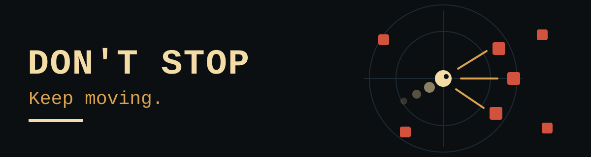
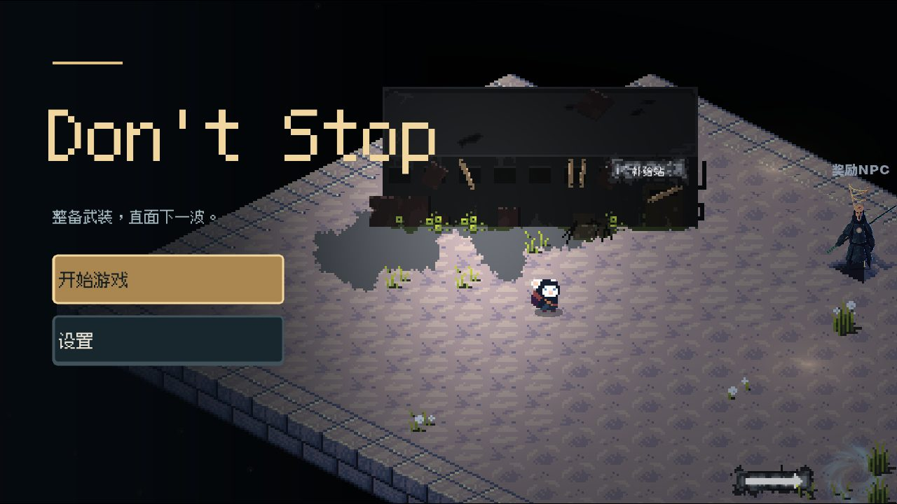
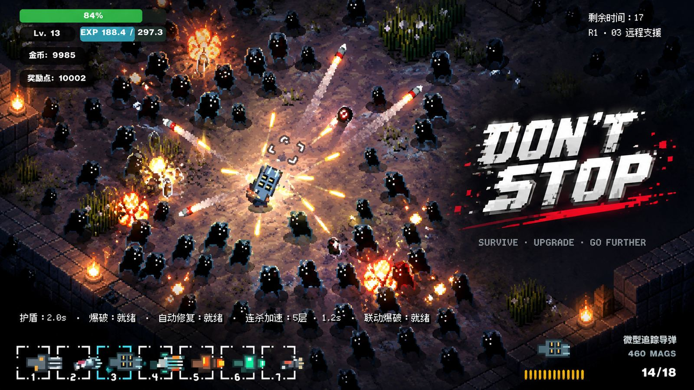

<p align="center">
  
</p>

A top-down 2D survival shooter. Fight through an escalating route of encounters, return to camp to rebuild your loadout, and go again.

**[Play in your browser](https://seiya058904.github.io/Dont-stop/)** · [Windows download](https://github.com/seiya058904/Dont-stop/releases/latest) · [Controls](#how-to-play) · [Development](#development)

[](https://github.com/seiya058904/Dont-stop/actions/workflows/deploy-pages.yml) [](https://github.com/seiya058904/Dont-stop/actions/workflows/native-tests.yml)

Built with Godot 4.7.2 for the web and Windows x64. Current release: [v1.3.6](https://github.com/seiya058904/Dont-stop/releases/tag/v1.3.6). The in-game interface is in Chinese; this README is in English.



*The title screen of the live web build, captured at 1280×720 from a fresh browser profile.*

## Features

- **24 weapons.** The catalog spans spread and straight-fire guns, arc chains, and plasma orbs, each with its own tier, price, and handling. You carry up to seven and switch with the number keys.
- **A camp between every run.** Buy and upgrade weapons, restock ammunition, spend talent points, then deploy. The camp's weapon tab lets you search and filter the catalog.
- **A 30-encounter normal route.** Pressure builds through enemy waves, equipment choices, and boss fights.
- **Hell stages 31–40.** Difficulty comes from combined enemy density, special enemies, elites, hazards, and reduced visibility. Enemy health, damage, speed, and density each ramp within bounded ranges instead of an unbounded stat multiplier ([`HellMode.gd`](Don't%20stop/game/config/HellMode.gd)).
- **Readable combat.** Weapon effects, hit feedback, enemy telegraphs, and a focused HUD show what is dangerous without hiding the action.
- **Saves you can trust.** The web build reports a save as successful only after the snapshot is committed to and verified in the browser's IndexedDB. If persistence fails, retry, export, and discard options stay available.

## How to Play

Each run follows one loop: **move, fight, collect, return to camp, build, go again.** Reloading, dashing, picking a target, and finding a safe angle all matter, even with a strong weapon.

| Input | Action |
| --- | --- |
| WASD or arrow keys | Move |
| Mouse | Aim |
| Left mouse button | Fire |
| R | Reload |
| Shift | Dash |
| 1–7 | Switch weapons |
| E or Tab | Open the camp or loadout |

The game is designed for mouse and keyboard. The web build can behave differently depending on browser, GPU, and device, so do not treat it as a performance benchmark for the native Windows build.

## Play and Download

- **Web:** play at <https://seiya058904.github.io/Dont-stop/> in a desktop browser. It is the Godot Web export, deployed through GitHub Pages.
- **Windows:** download `Don.t.Stop-v1.3.6-Windows-x64.zip` from the [v1.3.6 release](https://github.com/seiya058904/Dont-stop/releases/tag/v1.3.6), extract it, and run the game from the extracted files. A separate Web ZIP, SHA-256 checksum files, and a publication preflight record are attached to the same release. A downloaded Web export must be served from an HTTP server rather than opened as a file.

> [!IMPORTANT]
> Local saves are not cloud synchronization. Browser storage can be cleared or unavailable, and native Windows saves stay in their own local environment. Preserve important progress before resetting storage, changing browser profiles, or removing user data. A save warning is not a successful backup.

## Development

The Git repository root is not the Godot project root. Open [`Don't stop/project.godot`](Don't%20stop/project.godot) with Godot 4.7.2, and quote the directory name in command-line tools:

```bash
"$GODOT" --path "Don't stop"
```

| Path | Responsibility |
| --- | --- |
| [`Don't stop/boot/`](Don't%20stop/boot/) | Startup and loading flow |
| [`Don't stop/game/`](Don't%20stop/game/) | Player, weapons, enemies, maps, encounters, and combat |
| [`Don't stop/autoload/`](Don't%20stop/autoload/) | Shared game state and persistence services |
| [`Don't stop/ui/`](Don't%20stop/ui/) | Camp, loadout, HUD, and interface screens |
| [`Don't stop/tests/`](Don't%20stop/tests/) | Native regression scenarios |
| [`Don't stop/tools/`](Don't%20stop/tools/) | Verification, web testing, and build-identity utilities |
| [`Don't stop/web/loader.html`](Don't%20stop/web/loader.html) | Browser export loading screen |

[`Don't stop/PLAY_GAME.bat`](Don't%20stop/PLAY_GAME.bat) is a workspace-specific development launcher that relies on a local portable Godot install; it is not a distributable installer.

Verification is tiered, so a small change does not need a full release test. From the Git root:

```bash
python "Don't stop/tools/verify.py" verify-fast --base origin/main
```

Broader tiers are `verify-web`, `verify-native`, `verify-full`, and `verify-release`. They need the matching Godot, browser, and test environment, and the full native suite and web stress checks take considerably longer. The release workflow carries the same tested web artifact through verification and deployment and checks the deployed build's identity. Historical test results apply to the code and asset hashes they were run against, not to later revisions.

Further reading: [repository guidance](AGENTS.md), [Godot project play guide](Don't%20stop/README-PLAY.md), [v1.3.4 save audit](Don't%20stop/docs/iteration/release-v1.3.4.md), and [presentation and performance work](Don't%20stop/docs/iteration/deep-pass.md).

## Concept Art

Concept art made for this project. It is an illustration, not a screenshot, and details may differ from the shipped interface.



## Origins and License

Don't Stop is a derivative of [SakuyaCN/TowDownGame](https://github.com/SakuyaCN/TowDownGame). Its upstream README identifies that project as using the GNU General Public License; this repository does not assume a specific GPL version without a verified licensing source. Keep the upstream attribution, and review the applicable upstream and asset licenses before redistributing derivative builds.
